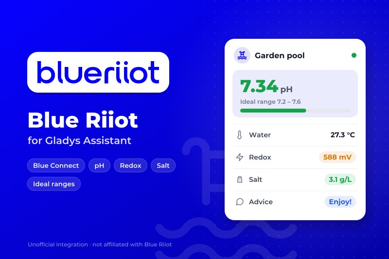
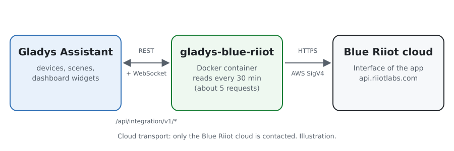
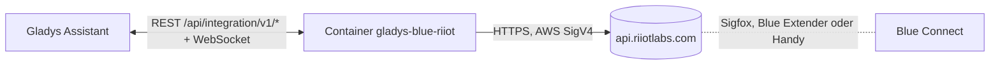
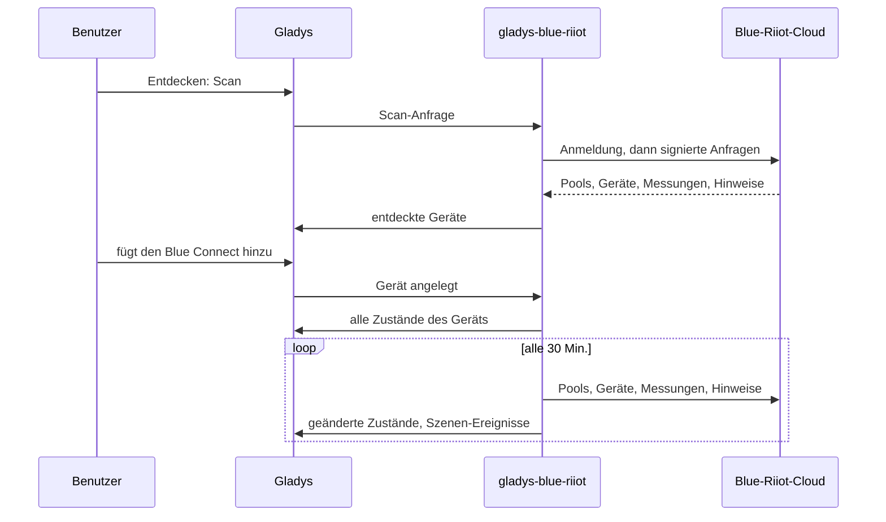
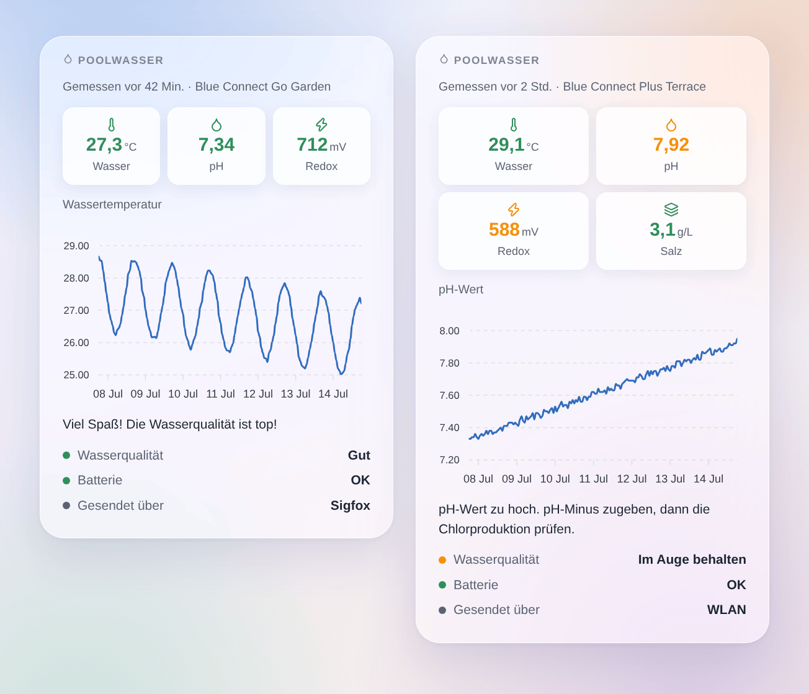

# Gladys Blue Riiot

[English](README.md) · [Français](README.fr.md) · **Deutsch** · [Español](README.es.md)

[](LICENSE)
[](https://github.com/William-De71/gladys-blue-riiot/releases)
[](https://github.com/William-De71/gladys-blue-riiot/actions/workflows/release.yml)
[](https://gladysassistant.com)



Eine externe Integration für [Gladys Assistant](https://gladysassistant.com), die die Blue-Connect-Poolanalysatoren eines Blue-Riiot-Kontos in Gladys bringt. Wassertemperatur, pH-Wert, Redox, Salzgehalt, die Idealbereiche von Blue Riiot und die Hinweise der App werden zu Geräten, Szenen-Auslösern, Szenen-Aktionen und einem Dashboard-Widget.

## Funktionen

- Ein **Gerät pro Blue Connect**: Wassertemperatur, pH-Wert, Redox (ORP), Salzgehalt (bei den Modellen, die ihn messen), Wasserqualität, Hinweis der App, Batterie schwach.
- **6 Szenen-Auslöser**: neue Messung, Wert außerhalb seines Idealbereichs, Wert wieder im Bereich, neuer Hinweis, Batterie schwach, seit 48 Stunden keine Messung.
- **2 Szenen-Aktionen**: einen Blue Connect lesen (Teststreifen inklusive); den Blue Extender nach seiner neuesten Messung fragen.
- **1 Dashboard-Widget**: das Poolwasser auf einen Blick, Kacheln in den Farben der Idealbereiche von Blue Riiot, der Verlauf eines Werts und der Hinweis der App.
- Nur lesend, etwa fünf Anfragen pro Lesen; ein abgelehntes Passwort wird nie von selbst erneut versucht, damit das Konto nicht gesperrt wird.
- Englisch, Französisch, Deutsch und Spanisch überall.

## Funktionsweise





Blue Riiot hat weder eine lokale noch eine öffentliche API: Der Blue Connect sendet seine Messungen an die Blue-Riiot-Cloud (per Sigfox, über einen Blue Extender oder über das Handy per Bluetooth), und die Integration liest sie über die **Cloud-Schnittstelle der Blue-Connect-App**, mit E-Mail-Adresse und Passwort des Kontos. Die Anmeldung liefert temporäre AWS-Zugangsdaten, die stündlich erneuert werden; jede Anfrage wird mit AWS SigV4 signiert (`execute-api`, `eu-west-1`), auf Basis von `node:crypto` geschrieben und gegen botocore geprüft. Standardmäßig alle 30 Minuten fragt ein Lesen die Pools, ihre Blue-Geräte, die letzten Messungen (mit den in der App eingegebenen Teststreifen) und die Hinweise der App ab. Das erste Lesen nach einem Start dient als Referenz: Übergänge werden ab dem nächsten gemeldet.



Aus Gladys wird nichts gesteuert, es gibt keinen `set value`-Schritt. Der einzige Schreibzugriff ist die Szenen-Aktion „Extender abrufen“, die eine bereits erfasste Messung übernimmt.

### Transport

Nur **Cloud** (`"transports": ["cloud"]`): Gladys zeigt im Katalog das Cloud-Abzeichen. Die Integration spricht nur mit `api.riiotlabs.com`. Ihre E-Mail-Adresse und Ihr Passwort verlassen Ihr Netz nur für die Blue-Riiot-Anmeldung; keine Daten gehen anderswohin.

## Geräte und Funktionen

| Gerät                   | Funktion           | Gladys-Kategorie / -Typ                             |
| ----------------------- | ------------------ | --------------------------------------------------- |
| `<Modell>` `<Poolname>` | Wassertemperatur   | Temperatursensor, °C                                |
|                         | pH-Wert            | pH-Sensor                                           |
|                         | Redox (ORP)        | ORP-Sensor, mV                                      |
|                         | Salzgehalt         | Füllstandssensor, ppm (Modelle mit Salz)            |
|                         | Wasserqualität     | Text: Gut, Im Auge behalten, Außerhalb des Bereichs |
|                         | Blue-Riiot-Hinweis | Text                                                |
|                         | Batterie schwach   | Batterie schwach (binär)                            |

Die externen IDs beruhen auf der Seriennummer des Blue Connect, wie die Cloud sie kennt, nie auf einem Namen. Blue Riiot sendet den Salzgehalt in g/L; Gladys hat keine Einheit g/L, daher speichert das Gerät ihn in ppm (mg/L, 3,2 g/L = 3200 ppm) und das Widget zeigt g/L. Die Wasserqualität ist der schlechteste Wert aus pH, Redox und Salzgehalt, gemessen an den Idealbereichen, die Blue Riiot mit jeder Messung sendet; Teststreifen und abgelaufene Werte zählen nie.

## Szenen-Auslöser, -Aktionen und Widget

| Art      | Schlüssel          | Verwendung                                                                               |
| -------- | ------------------ | ---------------------------------------------------------------------------------------- |
| Auslöser | `new_measure`      | Der Blue Connect hat eine neue Messung gesendet (alle Werte als Variablen)               |
| Auslöser | `out_of_range`     | Ein Messwert verlässt seinen Idealbereich oder wird schlechter (Filter: Messwert, Stufe) |
| Auslöser | `back_in_range`    | Ein Messwert kehrt in seinen Idealbereich zurück (Filter auf den Messwert)               |
| Auslöser | `new_advice`       | Die App gibt einen anderen Hinweis (Code, Titel, Nachricht)                              |
| Auslöser | `battery_low`      | Die Batterie des Blue Connect wird schwach                                               |
| Auslöser | `measures_stopped` | Seit 48 Stunden keine Messung (einmal ausgelöst)                                         |
| Aktion   | `get_device`       | Letzte Messungen, Teststreifen, Qualität und Hinweis als Szenen-Ausgaben                 |
| Aktion   | `fetch_measure`    | Den Blue Extender nach seiner neuesten Messung fragen (höchstens alle 10 Minuten)        |
| Widget   | `pool`             | Kacheln in den Farben der Idealbereiche, Verlaufsdiagramm, Hinweis, Qualität, Batterie   |

Szenen-Beispiele:

- Wenn der pH-Wert den Bereich verlässt → eine Nachricht mit `{{triggerEvent.data.summary}}` senden.
- Wenn der Redox-Wert kritisch ist → die Steckdose der Salzelektrolyse für zwei Stunden einschalten.
- Wenn die Batterie des Blue Connect schwach wird → „Blue Connect aufladen“ auf die Einkaufsliste setzen.
- Jeden Abend um 20 Uhr → den Blue Connect lesen und „Wasser bei {{…temperature}} °C, {{…water_quality_text}}“ senden.



## Voraussetzungen

- Gladys Assistant **5.3.0** oder neuer (Katalog-Schlüsselwörter von Gladys 5.3, Widgets und Szenen externer Integrationen). Ältere Instanzen können sie nicht installieren.
- Ein Blue Connect (Go, Plus, Gold…), der bereits in der Blue-Connect-App funktioniert, sowie E-Mail-Adresse und Passwort dieses Kontos.

## Installation

- **Aus dem Store**: Integrationen → „Blue Riiot“ suchen → Installieren.
- **Über die URL des Repositorys**: Integrationen → Integration installieren → `https://github.com/William-De71/gladys-blue-riiot`.
- **Entwicklermodus**: Integrationen → Integration installieren → Entwicklermodus, mit dem Image `ghcr.io/william-de71/gladys-blue-riiot:<version>`.

## Konfiguration

| Feld                 | Pflicht | Beschreibung                                                                         |
| -------------------- | ------- | ------------------------------------------------------------------------------------ |
| E-Mail               | Ja      | Die E-Mail-Adresse des Blue-Connect-Kontos                                           |
| Passwort             | Ja      | Als Geheimnis gespeichert, nie in den Logs, nur an die Blue-Riiot-Anmeldung gesendet |
| Leseintervall (Min.) | Nein    | 10 bis 120, standardmäßig 30                                                         |
| Sprache der Texte    | Nein    | Funktionsnamen, Hinweise der App, Zusammenfassungen; standardmäßig automatisch       |

**Konto testen** meldet sich an und zählt die Pools und Blue-Connect-Geräte. Lehnt Blue Riiot das Passwort ab, pausiert das Lesen, damit das Konto nicht gesperrt wird: Korrigieren und speichern Sie es oder nutzen Sie die Schaltfläche.

## Verwendung

1. Geben Sie E-Mail-Adresse und Passwort der Blue-Connect-App ein und speichern Sie.
2. Geräte → Blue Riiot → Entdecken: Fügen Sie den Blue Connect hinzu.
3. Szenen: Wählen Sie einen Blue-Riiot-Auslöser, filtern Sie auf ein Gerät oder einen Messwert, nutzen Sie die Variablen in einer Nachricht.
4. Dashboard: Fügen Sie das Widget „Poolwasser“ hinzu und wählen Sie das Diagramm.

Die Benutzerdokumentation steht in [docs/de.md](docs/de.md) ([en](docs/en.md), [fr](docs/fr.md), [es](docs/es.md)).

## Entwicklung

```bash
npm install
npm test                       # node --test, ohne Netzwerkzugriff
npm run lint                   # ESLint
npm run format:check           # Prettier
npx github:GladysAssistant/integration-store . --skip-image-check
scripts/build-cover.sh         # cover.jpg aus docs/assets/cover.svg
docs/illustrations/render.sh   # docs/assets/widgets.<lang>.png
```

Lokal liest das SDK `GLADYS_HOST_API_URL`, `GLADYS_INTEGRATION_TOKEN` und `GLADYS_INTEGRATION_SELECTOR` (von Gladys im Entwicklermodus geliefert). `DEBUG=gladys-integration-sdk` zeigt die Logs des SDK.

Die Tests decken die SigV4-Signatur (gegen von botocore erzeugte Signaturen), den Blue-Riiot-Client (Anmeldung, Erneuerung, Fehler), das Lesen der Antworten, die Übergänge, die Geräte (die Felder, die der Bildschirm Entdecken verlangt), das Widget (`validateWidgetContent`), die Szenen-Ereignisse und -Ausgaben, das Manifest, die vier Sprachen, das Release-Skript und die ganze Integration gegen das falsche Gladys des SDK und eine falsche Blue-Riiot-Cloud ab. `test/structure.test.js` friert jeden Schlüssel ein, den Benutzer speichern.

## Release-Prozess


Jeder Merge auf `main` startet die CI und berechnet dann die Version aus den [Conventional Commits](https://www.conventionalcommits.org/) seit dem letzten Tag: `feat` → Minor, `fix` / `perf` → Patch, `!` oder `BREAKING CHANGE` → Major (Minor unter 1.0.0); `docs`, `chore`, `ci`, `test`, `style`, `refactor`, `build` allein veröffentlichen nichts. Der Changelog-Abschnitt wird erzeugt, der Tag gepusht, das Multi-Architektur-Image gebaut, dann erhält `main` den Release-Commit, das GitHub-Release wird erstellt und ein letzter Job prüft das öffentliche Image, den Store-Validator und das Topic.

- Der Titel des Pull Requests wird zum Squash-Commit und dann zur Changelog-Zeile: Schreiben Sie ihn auf Englisch, für den Benutzer (`pr-title.yml` prüft ihn). Bearbeiten Sie `CHANGELOG.md` nie von Hand.
- 1.0.0 ist eine Entscheidung: Actions → Release → Run workflow mit `release-as: 1.0.0`. `dry-run` zeigt Version und Notizen, ohne zu veröffentlichen.
- **Geschützter Branch**: Rulesets verlangen einen Pull Request auf `main` und sperren die `v*`-Tags; nur der Maintainer und Deploy Keys kommen durch. Das Release pusht mit dem Deploy Key der Umgebung `release` (Secret `RELEASE_DEPLOY_KEY`, nur `main`): Ein Lauf von einem anderen Branch erhält ihn nie. `build.yml` und `github-release.yml` starten nicht bei einem Tag: Das Release ruft sie auf, oder starten Sie sie von Hand (Actions → Run workflow, mit `version` für das Image), um ein Release abzuschließen.
- Machen Sie nach dem ersten Release das `ghcr.io`-Paket öffentlich (Package settings → Change visibility), sonst kann Gladys es nicht laden.

## Fehlerbehebung

Siehe [docs/de.md](docs/de.md#fehlerbehebung). Melden Sie Probleme mit den Versionen von Gladys und der Integration und den Logs (`DEBUG=gladys-integration-sdk`).

## Mitwirken

Issues und Pull Requests sind willkommen. Führen Sie vor einem Pull Request `npm run format:check && npm run lint && npm test` aus und lassen Sie alle externen IDs und gespeicherten Schlüssel unverändert (siehe [CLAUDE.md](CLAUDE.md)).

## Sicherheit

Siehe [SECURITY.md](SECURITY.md): Melden Sie Schwachstellen vertraulich. Das Passwort ist ein `secret`-Feld und steht nie in den Logs; die temporären AWS-Zugangsdaten bleiben im Arbeitsspeicher.

## Kommende Screenshots

Die Bilder oben sind Illustrationen, keine Screenshots. Echte Screenshots kommen nach `docs/assets/screenshots/` (PNG, 1280 × 800): `configuration.png`, `discovery.png`, `device.png`, `scene.png`.

## Lizenz

[Apache-Lizenz 2.0](LICENSE) — siehe auch [NOTICE](NOTICE). Blue Riiot und Blue Connect sind Marken ihres Inhabers; diese Community-Integration ist nicht mit Blue Riiot verbunden und nutzt eine Schnittstelle, die Blue Riiot nicht dokumentiert und die sich ändern kann. Die Beschreibung dieser Schnittstelle stammt aus [python-blueconnect](https://github.com/marcelveldt/python-blueconnect) (Apache-2.0). Dank an die Dokumentation und das SDK von Gladys.
