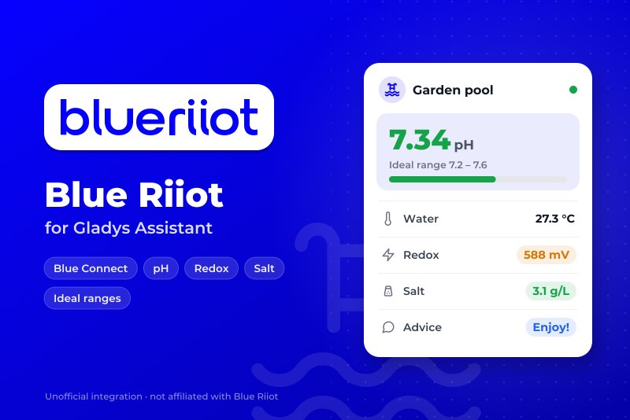
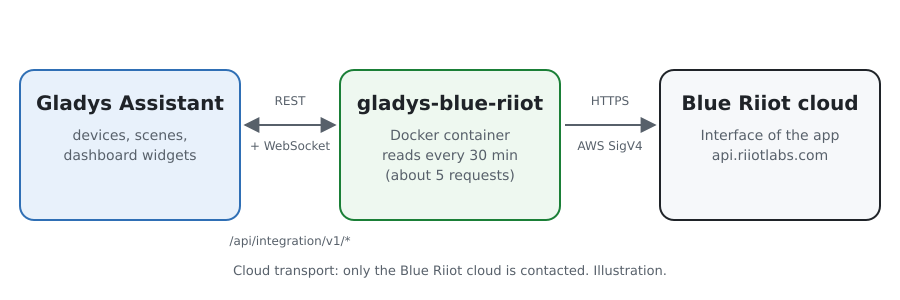
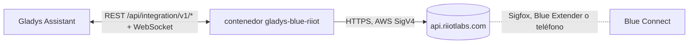
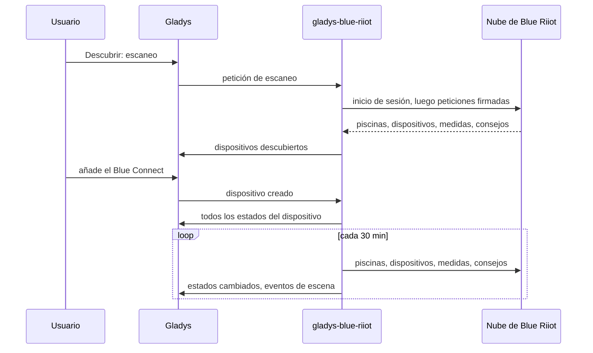
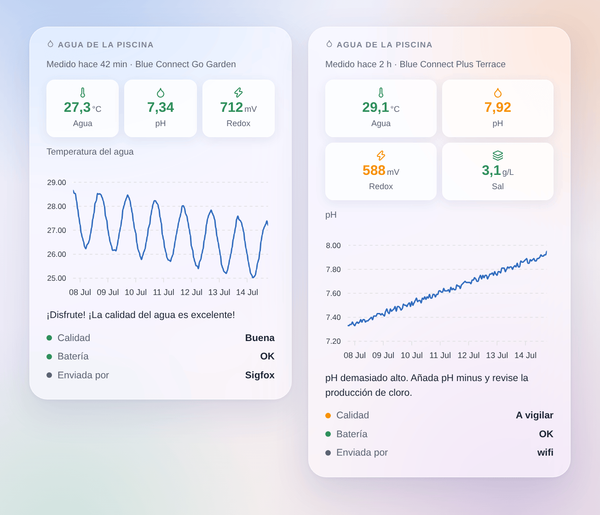

# Gladys Blue Riiot

[English](README.md) · [Français](README.fr.md) · [Deutsch](README.de.md) · **Español**

[](LICENSE)
[](https://github.com/William-De71/gladys-blue-riiot/releases)
[](https://github.com/William-De71/gladys-blue-riiot/actions/workflows/release.yml)
[](https://gladysassistant.com)



Una integración externa para [Gladys Assistant](https://gladysassistant.com) que trae a Gladys los analizadores de piscina Blue Connect de una cuenta Blue Riiot. La temperatura del agua, el pH, el redox, la salinidad, los rangos ideales de Blue Riiot y los consejos de la aplicación se convierten en dispositivos, disparadores de escena, acciones de escena y un widget de panel.

## Funcionalidades

- Un **dispositivo por Blue Connect**: temperatura del agua, pH, redox (ORP), salinidad (en los modelos que la miden), calidad del agua, consejo de la aplicación, batería baja.
- **6 disparadores de escena**: nueva medida, valor fuera de su rango ideal, valor de nuevo en el rango, nuevo consejo, batería baja, ninguna medida desde hace 48 horas.
- **2 acciones de escena**: leer un Blue Connect (tiras de prueba incluidas); pedir al Blue Extender su última medida.
- **1 widget de panel**: el agua de la piscina de un vistazo, casillas coloreadas según los rangos ideales de Blue Riiot, el historial de un valor y el consejo de la aplicación.
- Solo lectura, unas cinco peticiones por lectura; una contraseña rechazada nunca se reintenta sola, para no bloquear la cuenta.
- Inglés, francés, alemán y español en todas partes.

## Funcionamiento





Blue Riiot no tiene API local ni API pública: el Blue Connect envía sus medidas a la nube de Blue Riiot (por Sigfox, a través de un Blue Extender o a través del teléfono por Bluetooth), y la integración las lee mediante la **interfaz en la nube de la aplicación Blue Connect**, con el correo y la contraseña de la cuenta. El inicio de sesión devuelve credenciales AWS temporales, renovadas cada hora; cada petición se firma con AWS SigV4 (`execute-api`, `eu-west-1`), escrita sobre `node:crypto` y comprobada frente a botocore. Cada 30 minutos por defecto, una lectura pide las piscinas, sus dispositivos Blue, las últimas medidas (con las tiras de prueba introducidas en la aplicación) y los consejos de la aplicación. La primera lectura tras un arranque sirve de referencia: las transiciones se señalan a partir de la siguiente.



Nada se controla desde Gladys, no hay paso `set value`. La única escritura es la acción de escena «recoger del Extender», que hace llegar una medida ya tomada.

### Transporte

Solo **nube** (`"transports": ["cloud"]`): Gladys muestra la insignia Nube en el catálogo. La integración solo habla con `api.riiotlabs.com`. Su correo y su contraseña solo salen de su red para el inicio de sesión de Blue Riiot; ningún dato va a otro sitio.

## Dispositivos y funciones

| Dispositivo                         | Función               | Categoría / tipo Gladys                 |
| ----------------------------------- | --------------------- | --------------------------------------- |
| `<modelo>` `<nombre de la piscina>` | Temperatura del agua  | Sensor de temperatura, °C               |
|                                     | pH                    | Sensor de pH                            |
|                                     | Redox (ORP)           | Sensor ORP, mV                          |
|                                     | Salinidad             | Sensor de nivel, ppm (modelos con sal)  |
|                                     | Calidad del agua      | Texto: Buena, A vigilar, Fuera de rango |
|                                     | Consejo de Blue Riiot | Texto                                   |
|                                     | Batería baja          | Batería baja (binario)                  |

Los identificadores externos se basan en el número de serie del Blue Connect tal como lo conoce la nube, nunca en un nombre. Blue Riiot envía la salinidad en g/L; Gladys no tiene unidad g/L, así que el dispositivo la guarda en ppm (mg/L, 3,2 g/L = 3200 ppm) y el widget la muestra en g/L. La calidad del agua es la peor de las del pH, el redox y la salinidad frente a los rangos ideales que Blue Riiot envía con cada medida; las tiras de prueba y los valores caducados nunca cuentan.

## Disparadores, acciones de escena y widget

| Tipo       | Clave              | Uso                                                                                           |
| ---------- | ------------------ | --------------------------------------------------------------------------------------------- |
| Disparador | `new_measure`      | El Blue Connect envió una nueva medida (todos los valores como variables)                     |
| Disparador | `out_of_range`     | Una medida sale de su rango ideal o empeora (filtro por medida y nivel)                       |
| Disparador | `back_in_range`    | Una medida vuelve a su rango ideal (filtro por medida)                                        |
| Disparador | `new_advice`       | La aplicación da otro consejo (código, título, mensaje)                                       |
| Disparador | `battery_low`      | La batería del Blue Connect pasa a baja                                                       |
| Disparador | `measures_stopped` | Ninguna medida desde hace 48 horas (se dispara una vez)                                       |
| Acción     | `get_device`       | Las últimas medidas, tiras de prueba, calidad y consejo como salidas de escena                |
| Acción     | `fetch_measure`    | Pedir al Blue Extender su última medida (como mucho cada 10 minutos)                          |
| Widget     | `pool`             | Casillas coloreadas según los rangos ideales, gráfico de historial, consejo, calidad, batería |

Ejemplos de escenas:

- Cuando el pH sale de su rango → enviar un mensaje con `{{triggerEvent.data.summary}}`.
- Cuando el redox es crítico → encender el enchufe del clorador salino durante dos horas.
- Cuando la batería del Blue Connect pasa a baja → añadir «cargar el Blue Connect» a la lista de la compra.
- Cada tarde a las 20:00 → leer el Blue Connect y enviar «agua a {{…temperature}} °C, {{…water_quality_text}}».



## Requisitos

- Gladys Assistant **5.3.0** o posterior (palabras clave del catálogo de Gladys 5.3, widgets y escenas de las integraciones externas). Las instancias más antiguas no pueden instalarla.
- Un Blue Connect (Go, Plus, Gold…) que ya funcione en la aplicación Blue Connect, y el correo y la contraseña de esa cuenta.

## Instalación

- **Desde la tienda**: Integraciones → buscar «Blue Riiot» → Instalar.
- **Desde la URL del repositorio**: Integraciones → Instalar una integración → `https://github.com/William-De71/gladys-blue-riiot`.
- **Modo desarrollador**: Integraciones → Instalar una integración → Modo desarrollador, con la imagen `ghcr.io/william-de71/gladys-blue-riiot:<version>`.

## Configuración

| Campo                      | Obligatorio | Descripción                                                                              |
| -------------------------- | ----------- | ---------------------------------------------------------------------------------------- |
| Correo electrónico         | Sí          | El correo de la cuenta Blue Connect                                                      |
| Contraseña                 | Sí          | Guardada como secreto, nunca en los logs, solo enviada al inicio de sesión de Blue Riiot |
| Intervalo de lectura (min) | No          | De 10 a 120, 30 por defecto                                                              |
| Idioma de los textos       | No          | Nombres de funciones, consejos de la aplicación, resúmenes; automático por defecto       |

**Probar la cuenta** inicia sesión y cuenta las piscinas y los dispositivos Blue Connect. Cuando Blue Riiot rechaza la contraseña, las lecturas se ponen en pausa para no bloquear la cuenta: corríjala y guarde, o use el botón.

## Uso

1. Introduzca el correo y la contraseña de la aplicación Blue Connect y guarde.
2. Dispositivos → Blue Riiot → Descubrir: añada el Blue Connect.
3. Escenas: elija un disparador Blue Riiot, filtre por un dispositivo o una medida, use las variables en un mensaje.
4. Panel: añada el widget «Agua de la piscina» y elija el gráfico.

La documentación de usuario está en [docs/es.md](docs/es.md) ([en](docs/en.md), [fr](docs/fr.md), [de](docs/de.md)).

## Desarrollo

```bash
npm install
npm test                       # node --test, sin tocar nunca la red
npm run lint                   # ESLint
npm run format:check           # Prettier
npx github:GladysAssistant/integration-store . --skip-image-check
scripts/build-cover.sh         # cover.jpg a partir de docs/assets/cover.svg
docs/illustrations/render.sh   # docs/assets/widgets.<lang>.png
```

En local, el SDK lee `GLADYS_HOST_API_URL`, `GLADYS_INTEGRATION_TOKEN` y `GLADYS_INTEGRATION_SELECTOR` (que Gladys da en modo desarrollador). `DEBUG=gladys-integration-sdk` muestra los logs del SDK.

Las pruebas cubren la firma SigV4 (frente a firmas hechas por botocore), el cliente Blue Riiot (inicio de sesión, renovación, errores), la lectura de las respuestas, las transiciones, los dispositivos (los campos que exige la pantalla Descubrir), el widget (`validateWidgetContent`), los eventos y salidas de escena, el manifiesto, los cuatro idiomas, el script de release, y toda la integración frente al Gladys falso del SDK y una nube Blue Riiot falsa. `test/structure.test.js` congela todas las claves que guardan los usuarios.

## Proceso de release


Cada fusión en `main` lanza la CI y calcula la versión a partir de los [Conventional Commits](https://www.conventionalcommits.org/) desde la última etiqueta: `feat` → menor, `fix` / `perf` → parche, `!` o `BREAKING CHANGE` → mayor (menor por debajo de 1.0.0); `docs`, `chore`, `ci`, `test`, `style`, `refactor`, `build` solos no publican nada. Se genera la sección del changelog, se empuja la etiqueta, se construye la imagen multiarquitectura, luego `main` recibe el commit de release, se crea la GitHub Release y un último job comprueba la imagen pública, el validador de la tienda y el topic.

- El título del pull request se convierte en el commit squash y luego en la línea del changelog: escríbalo en inglés, para el usuario (`pr-title.yml` lo comprueba). No edite nunca `CHANGELOG.md` a mano.
- La 1.0.0 es una decisión: Actions → Release → Run workflow con `release-as: 1.0.0`. `dry-run` muestra la versión y las notas sin publicar.
- **Rama protegida**: unos rulesets exigen una pull request en `main` y bloquean las etiquetas `v*`; solo pasan el mantenedor y las deploy keys. La publicación hace push con la deploy key del entorno `release` (secreto `RELEASE_DEPLOY_KEY`, solo `main`): una ejecución lanzada desde otra rama nunca la obtiene. `build.yml` y `github-release.yml` no arrancan con una etiqueta: la publicación los llama, o lánzelos a mano (Actions → Run workflow, con `version` para la imagen) para terminar una publicación.
- Tras la primera release, haga público el paquete `ghcr.io` (Package settings → Change visibility), o Gladys no podrá descargarlo.

## Solución de problemas

Vea [docs/es.md](docs/es.md#solución-de-problemas). Informe de los problemas con las versiones de Gladys y de la integración y los logs (`DEBUG=gladys-integration-sdk`).

## Contribuir

Issues y pull requests son bienvenidos. Ejecute `npm run format:check && npm run lint && npm test` antes de abrir un pull request y mantenga sin cambios todos los identificadores externos y claves guardadas (vea [CLAUDE.md](CLAUDE.md)).

## Seguridad

Vea [SECURITY.md](SECURITY.md): informe de las vulnerabilidades en privado. La contraseña es un campo `secret`, nunca en los logs; las credenciales AWS temporales se quedan en memoria.

## Capturas por venir

Las imágenes de arriba son ilustraciones, no capturas de pantalla. Las capturas reales irán en `docs/assets/screenshots/` (PNG, 1280 × 800): `configuration.png`, `discovery.png`, `device.png`, `scene.png`.

## Licencia

[Licencia Apache 2.0](LICENSE) — vea también [NOTICE](NOTICE). Blue Riiot y Blue Connect son marcas de su propietario; esta integración comunitaria no está afiliada a Blue Riiot y usa una interfaz que Blue Riiot no documenta y que puede cambiar. La descripción de esa interfaz procede de [python-blueconnect](https://github.com/marcelveldt/python-blueconnect) (Apache-2.0). Gracias a la documentación y al SDK de Gladys.
