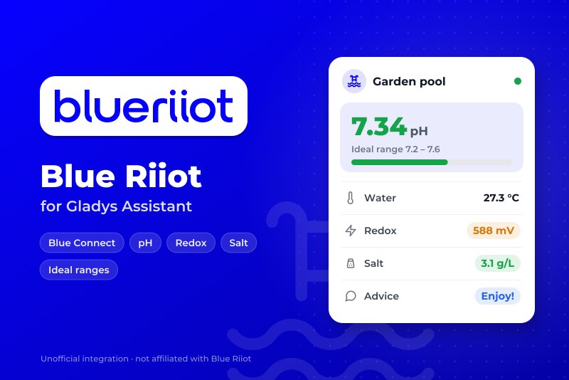
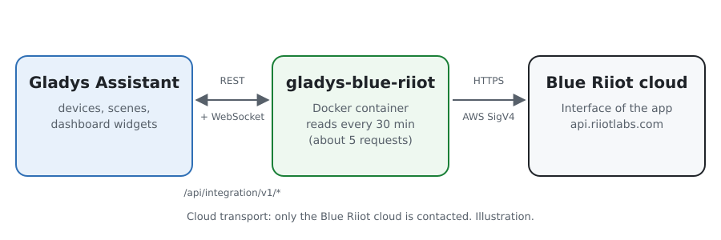
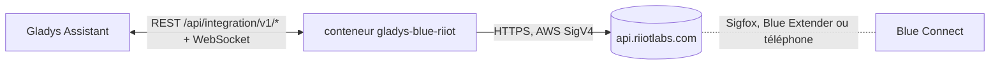
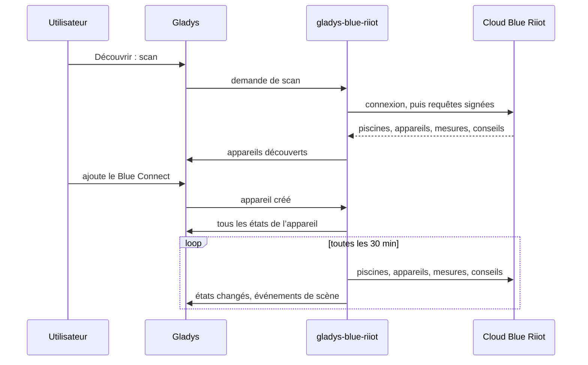
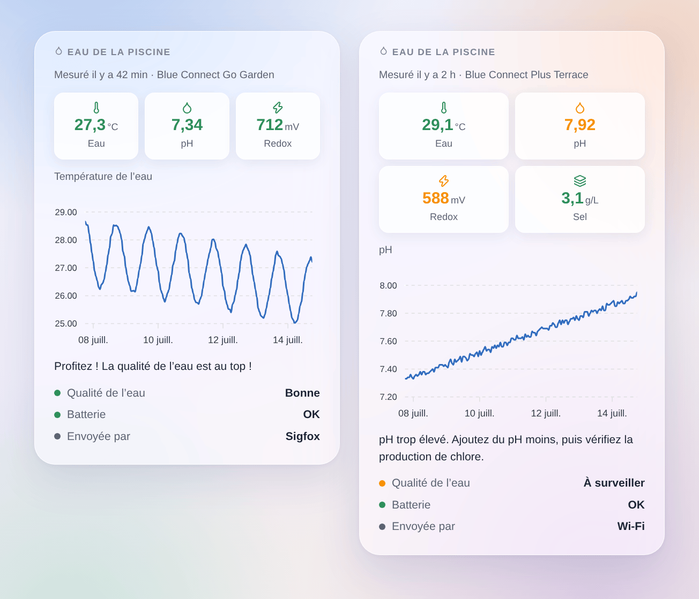

# Gladys Blue Riiot

[English](README.md) · **Français** · [Deutsch](README.de.md) · [Español](README.es.md)

[](LICENSE)
[](https://github.com/William-De71/gladys-blue-riiot/releases)
[](https://github.com/William-De71/gladys-blue-riiot/actions/workflows/release.yml)
[](https://gladysassistant.com)



Une intégration externe pour [Gladys Assistant](https://gladysassistant.com) qui amène dans Gladys les analyseurs de piscine Blue Connect d’un compte Blue Riiot. Température de l’eau, pH, redox, salinité, plages idéales de Blue Riiot et conseils de l’application deviennent des appareils, des déclencheurs de scène, des actions de scène et un widget de tableau de bord.

## Fonctionnalités

- Un **appareil par Blue Connect** : température de l’eau, pH, redox (ORP), salinité (sur les modèles qui la mesurent), qualité de l’eau, conseil de l’application, batterie faible.
- **6 déclencheurs de scène** : nouvelle mesure, valeur hors de sa plage idéale, valeur revenue dans la plage, nouveau conseil, batterie faible, aucune mesure depuis 48 heures.
- **2 actions de scène** : lire un Blue Connect (bandelettes de test comprises) ; demander au Blue Extender sa dernière mesure.
- **1 widget de tableau de bord** : l’eau de la piscine d’un coup d’œil, des tuiles colorées selon les plages idéales de Blue Riiot, l’historique d’une valeur et le conseil de l’application.
- Lecture seule, environ cinq requêtes par lecture ; un mot de passe refusé n’est jamais réessayé tout seul, pour ne pas bloquer le compte.
- Anglais, français, allemand et espagnol partout.

## Fonctionnement





Blue Riiot n’a ni API locale ni API publique : le Blue Connect envoie ses mesures au cloud Blue Riiot (par Sigfox, par un Blue Extender ou par le téléphone en Bluetooth), et l’intégration les lit par l’**interface cloud de l’application Blue Connect**, avec l’e-mail et le mot de passe du compte. La connexion renvoie des identifiants AWS temporaires, renouvelés toutes les heures ; chaque requête est signée en AWS SigV4 (`execute-api`, `eu-west-1`), une signature écrite sur `node:crypto` et vérifiée face à botocore. Toutes les 30 minutes par défaut, une lecture demande les piscines, leurs appareils Blue, les dernières mesures (avec les bandelettes saisies dans l’application) et les conseils de l’application. La première lecture après un démarrage sert de référence : les transitions sont signalées à partir de la suivante.



Rien ne se pilote depuis Gladys, il n’y a pas d’étape `set value`. La seule écriture est l’action de scène « relever l’Extender », qui fait remonter une mesure déjà prise.

### Transport

**Cloud** uniquement (`"transports": ["cloud"]`) : Gladys affiche le badge Cloud dans le catalogue. L’intégration ne parle qu’à `api.riiotlabs.com`. Votre e-mail et votre mot de passe ne quittent votre réseau que pour la connexion Blue Riiot ; aucune donnée ne part ailleurs.

## Appareils et fonctionnalités

| Appareil                     | Fonctionnalité       | Catégorie / type Gladys                   |
| ---------------------------- | -------------------- | ----------------------------------------- |
| `<modèle>` `<nom du bassin>` | Température de l’eau | Capteur de température, °C                |
|                              | pH                   | Capteur de pH                             |
|                              | Redox (ORP)          | Capteur ORP, mV                           |
|                              | Salinité             | Capteur de niveau, ppm (modèles avec sel) |
|                              | Qualité de l’eau     | Texte : Bonne, À surveiller, Hors plage   |
|                              | Conseil Blue Riiot   | Texte                                     |
|                              | Batterie faible      | Batterie faible (binaire)                 |

Les identifiants externes reposent sur le numéro de série du Blue Connect tel que le cloud le connaît, jamais sur un nom. Blue Riiot envoie la salinité en g/L ; Gladys n’a pas d’unité g/L, l’appareil la garde donc en ppm (mg/L, 3,2 g/L = 3200 ppm) et le widget l’affiche en g/L. La qualité de l’eau est la pire de celles du pH, du redox et de la salinité, comparés aux plages idéales que Blue Riiot envoie avec chaque mesure ; les bandelettes de test et les valeurs expirées ne comptent jamais.

## Déclencheurs, actions de scène et widget

| Type        | Clé                | Usage                                                                                        |
| ----------- | ------------------ | -------------------------------------------------------------------------------------------- |
| Déclencheur | `new_measure`      | Le Blue Connect a envoyé une nouvelle mesure (toutes les valeurs en variables)               |
| Déclencheur | `out_of_range`     | Une mesure sort de sa plage idéale ou s’aggrave (filtre sur la mesure, le niveau)            |
| Déclencheur | `back_in_range`    | Une mesure revient dans sa plage idéale (filtre sur la mesure)                               |
| Déclencheur | `new_advice`       | L’application donne un autre conseil (code, titre, message)                                  |
| Déclencheur | `battery_low`      | La batterie du Blue Connect devient faible                                                   |
| Déclencheur | `measures_stopped` | Aucune mesure depuis 48 heures (déclenché une fois)                                          |
| Action      | `get_device`       | Les dernières mesures, bandelettes, qualité et conseil en sorties de scène                   |
| Action      | `fetch_measure`    | Demander au Blue Extender sa dernière mesure (au plus toutes les 10 minutes)                 |
| Widget      | `pool`             | Tuiles colorées selon les plages idéales, graphique d’historique, conseil, qualité, batterie |

Exemples de scènes :

- Quand le pH sort de sa plage → envoyer un message avec `{{triggerEvent.data.summary}}`.
- Quand le redox est critique → allumer la prise de l’électrolyseur au sel pendant deux heures.
- Quand la batterie du Blue Connect devient faible → ajouter « recharger le Blue Connect » à la liste de courses.
- Chaque soir à 20 h → lire le Blue Connect et envoyer « eau à {{…temperature}} °C, {{…water_quality_text}} ».



## Prérequis

- Gladys Assistant **5.3.0** ou plus récent (mots-clés du catalogue de Gladys 5.3, widgets et scènes des intégrations externes). Les instances plus anciennes ne peuvent pas l’installer.
- Un Blue Connect (Go, Plus, Gold…) qui fonctionne déjà dans l’application Blue Connect, et l’e-mail et le mot de passe de ce compte.

## Installation

- **Depuis le store** : Intégrations → rechercher « Blue Riiot » → Installer.
- **Depuis l’URL du dépôt** : Intégrations → Installer une intégration → `https://github.com/William-De71/gladys-blue-riiot`.
- **Mode développeur** : Intégrations → Installer une intégration → Mode développeur, avec l’image `ghcr.io/william-de71/gladys-blue-riiot:<version>`.

## Configuration

| Champ                       | Obligatoire | Description                                                                               |
| --------------------------- | ----------- | ----------------------------------------------------------------------------------------- |
| E-mail                      | Oui         | L’e-mail du compte Blue Connect                                                           |
| Mot de passe                | Oui         | Enregistré comme secret, jamais dans les logs, envoyé seulement à la connexion Blue Riiot |
| Intervalle de lecture (min) | Non         | De 10 à 120, 30 par défaut                                                                |
| Langue des textes           | Non         | Noms des fonctionnalités, conseils de l’application, résumés ; automatique par défaut     |

**Tester le compte** se connecte et compte les piscines et les appareils Blue Connect. Quand Blue Riiot refuse le mot de passe, les lectures se mettent en pause pour ne pas bloquer le compte : corrigez-le et enregistrez, ou utilisez le bouton.

## Utilisation

1. Saisissez l’e-mail et le mot de passe de l’application Blue Connect, puis enregistrez.
2. Appareils → Blue Riiot → Découvrir : ajoutez le Blue Connect.
3. Scènes : choisissez un déclencheur Blue Riiot, filtrez sur un appareil ou une mesure, utilisez les variables dans un message.
4. Tableau de bord : ajoutez le widget « Eau de la piscine », choisissez le graphique.

La documentation utilisateur est dans [docs/fr.md](docs/fr.md) ([en](docs/en.md), [de](docs/de.md), [es](docs/es.md)).

## Développement

```bash
npm install
npm test                       # node --test, sans jamais toucher le réseau
npm run lint                   # ESLint
npm run format:check           # Prettier
npx github:GladysAssistant/integration-store . --skip-image-check
scripts/build-cover.sh         # cover.jpg depuis docs/assets/cover.svg
docs/illustrations/render.sh   # docs/assets/widgets.<lang>.png
```

En local, le SDK lit `GLADYS_HOST_API_URL`, `GLADYS_INTEGRATION_TOKEN` et `GLADYS_INTEGRATION_SELECTOR` (fournis par Gladys en mode développeur). `DEBUG=gladys-integration-sdk` affiche les logs du SDK.

Les tests couvrent la signature SigV4 (face à des signatures produites par botocore), le client Blue Riiot (connexion, renouvellement, erreurs), la lecture des réponses, les transitions, les appareils (les champs qu’exige l’écran Découvrir), le widget (`validateWidgetContent`), les événements et sorties de scène, le manifeste, les quatre langues, le script de release, et toute l’intégration face au faux Gladys du SDK et à un faux cloud Blue Riiot. `test/structure.test.js` fige toutes les clés que les utilisateurs enregistrent.

## Processus de release


Chaque fusion sur `main` lance la CI, puis calcule la version d’après les [Conventional Commits](https://www.conventionalcommits.org/) depuis le dernier tag : `feat` → mineure, `fix` / `perf` → correctif, `!` ou `BREAKING CHANGE` → majeure (mineure sous 1.0.0) ; `docs`, `chore`, `ci`, `test`, `style`, `refactor`, `build` seuls ne publient rien. La section du changelog est générée, le tag poussé, l’image multi-architecture construite, puis `main` reçoit le commit de release, la GitHub Release est créée et un dernier job vérifie l’image publique, le validateur du store et le topic.

- Le titre de la pull request devient le commit squash, puis la ligne du changelog : écrivez-le en anglais, pour l’utilisateur (`pr-title.yml` le vérifie). Ne modifiez jamais `CHANGELOG.md` à la main.
- La 1.0.0 est une décision : Actions → Release → Run workflow avec `release-as: 1.0.0`. `dry-run` affiche la version et les notes sans rien publier.
- **Branche protégée** : la release pousse son commit sur `main` avec `GITHUB_TOKEN`. Avec un ruleset sur `main` plus strict que « ni suppression ni force-push », ajoutez GitHub Actions à sa liste de contournement (ou poussez par une GitHub App), sinon le job de publication échoue avec des instructions.
- Après la première release, rendez public le package `ghcr.io` (Package settings → Change visibility), sinon Gladys ne peut pas le télécharger.

## Dépannage

Voir [docs/fr.md](docs/fr.md#dépannage). Signalez les problèmes avec les versions de Gladys et de l’intégration et les logs (`DEBUG=gladys-integration-sdk`).

## Contribuer

Issues et pull requests bienvenues. Lancez `npm run format:check && npm run lint && npm test` avant d’ouvrir une pull request, et gardez inchangés tous les identifiants externes et clés enregistrées (voir [CLAUDE.md](CLAUDE.md)).

## Sécurité

Voir [SECURITY.md](SECURITY.md) : signalez les failles en privé. Le mot de passe est un champ `secret`, jamais dans les logs ; les identifiants AWS temporaires restent en mémoire.

## Captures à venir

Les images ci-dessus sont des illustrations, pas des captures d’écran. Les vraies captures iront dans `docs/assets/screenshots/` (PNG, 1280 × 800) : `configuration.png`, `discovery.png`, `device.png`, `scene.png`.

## Licence

[Licence Apache 2.0](LICENSE) — voir aussi [NOTICE](NOTICE). Blue Riiot et Blue Connect sont des marques de leur propriétaire ; cette intégration communautaire n’est pas affiliée à Blue Riiot et utilise une interface que Blue Riiot ne documente pas et qui peut changer. La description de cette interface vient de [python-blueconnect](https://github.com/marcelveldt/python-blueconnect) (Apache-2.0). Merci à la documentation et au SDK de Gladys.
