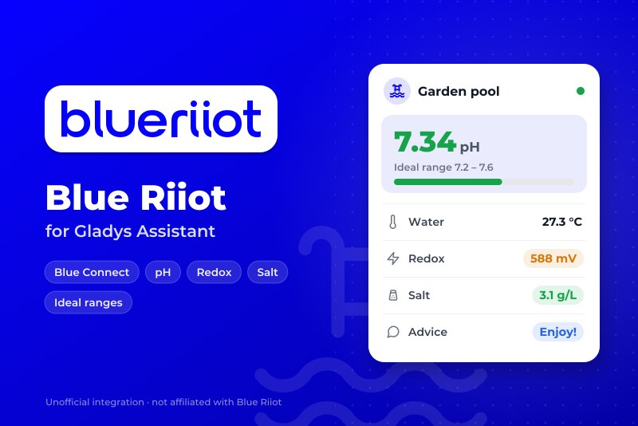
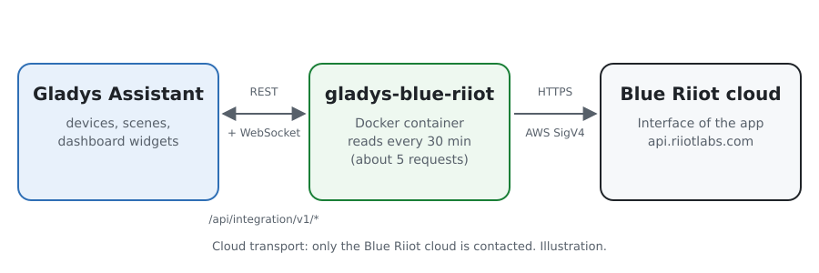
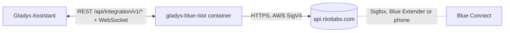
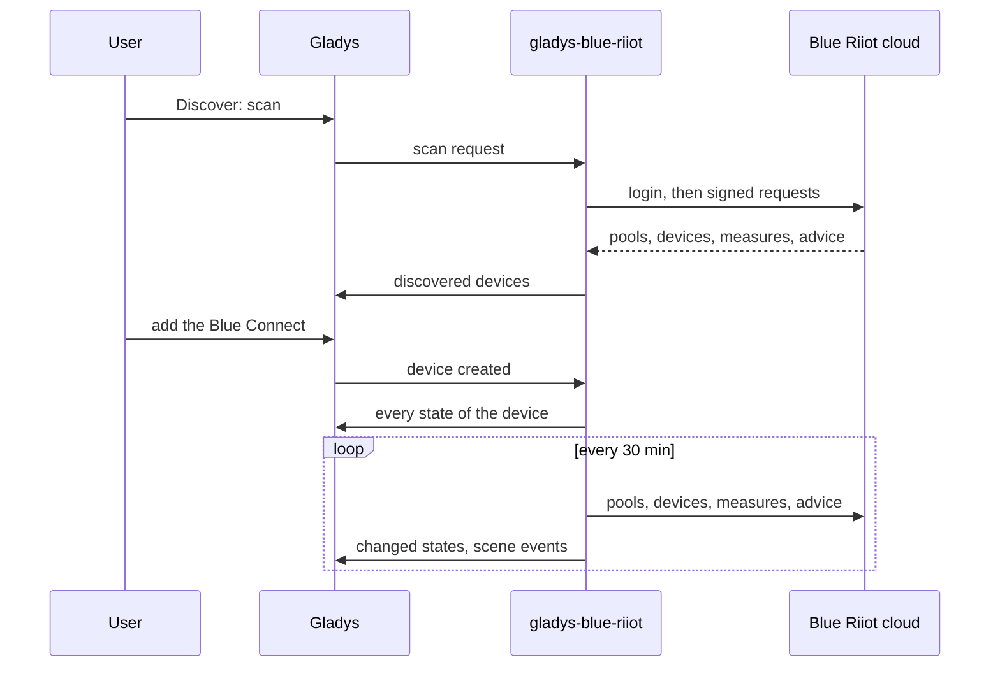
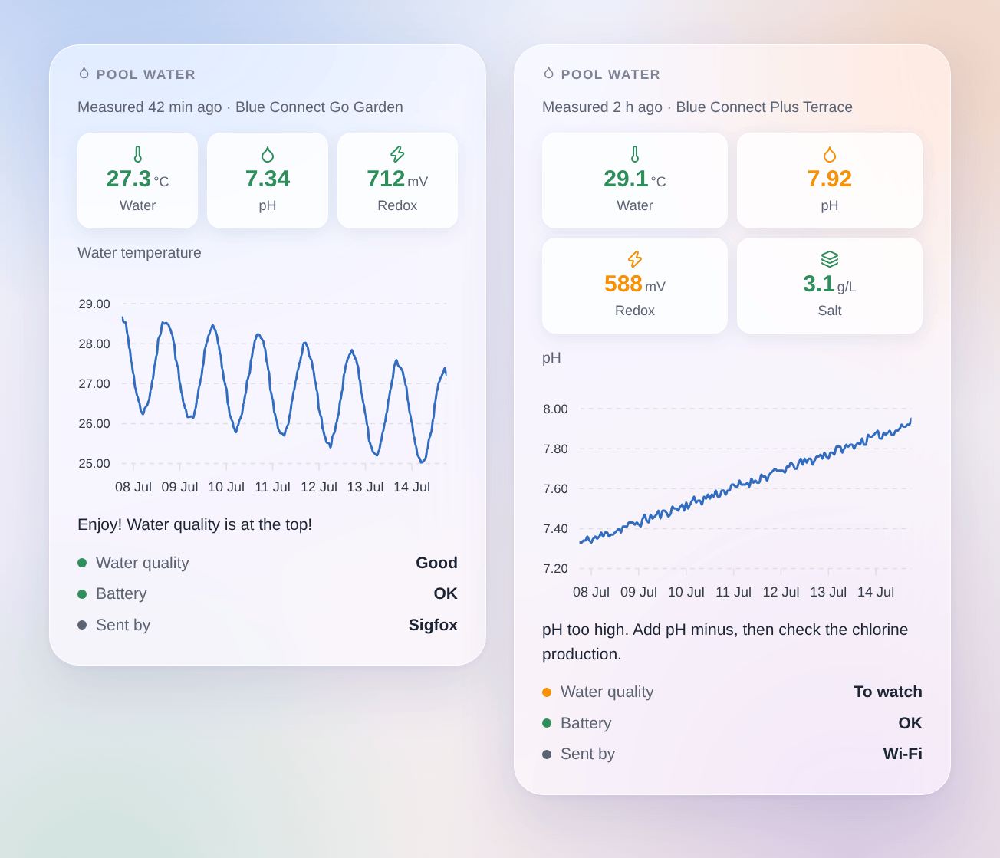

# Gladys Blue Riiot

**English** · [Français](README.fr.md) · [Deutsch](README.de.md) · [Español](README.es.md)

[](LICENSE)
[](https://github.com/William-De71/gladys-blue-riiot/releases)
[](https://github.com/William-De71/gladys-blue-riiot/actions/workflows/release.yml)
[](https://gladysassistant.com)



An external integration for [Gladys Assistant](https://gladysassistant.com) that brings the Blue Connect pool analysers of a Blue Riiot account into Gladys. Water temperature, pH, redox, salinity, the ideal ranges of Blue Riiot and the advice of the app become devices, scene triggers, scene actions and a dashboard widget.

## Features

- A **device per Blue Connect**: water temperature, pH, redox (ORP), salinity (on the models that measure it), water quality, advice of the app, battery low.
- **6 scene triggers**: new measure, value out of its ideal range, value back in range, new advice, battery low, no measure for 48 hours.
- **2 scene actions**: read a Blue Connect (test strips included); ask the Blue Extender for its newest measure.
- **1 dashboard widget**: the pool water at a glance, tiles colored by the ideal ranges of Blue Riiot, the history of one value and the advice of the app.
- Read-only, about five requests per reading; a refused password is never retried on its own, so the account is not locked.
- English, French, German and Spanish everywhere.

## How it works





Blue Riiot has no local API and no public one: the Blue Connect sends its measures to the Blue Riiot cloud (by Sigfox, through a Blue Extender, or through the phone over Bluetooth), and the integration reads them through the **cloud interface of the Blue Connect app**, with the e-mail and password of the account. The login returns temporary AWS credentials, renewed every hour; each request is signed with AWS SigV4 (`execute-api`, `eu-west-1`), written on `node:crypto` and checked against botocore. Every 30 minutes by default, a reading asks for the pools, their Blue devices, the last measures (with the test strips entered in the app) and the advice of the app. The first reading after a start is a reference: transitions are reported from the next one on.



Nothing is controlled from Gladys, there is no `set value` step. The only write is the "ask the Blue Extender" scene action, which hands over a measure already taken.

### Transport

**Cloud** only (`"transports": ["cloud"]`): Gladys shows the Cloud badge in the catalog. The integration talks to `api.riiotlabs.com` and nothing else. Your e-mail and password leave your network for the Blue Riiot login only; no data goes anywhere else.

## Devices and features

| Device                  | Feature           | Gladys category / type               |
| ----------------------- | ----------------- | ------------------------------------ |
| `<model>` `<pool name>` | Water temperature | Temperature sensor, °C               |
|                         | pH                | pH sensor                            |
|                         | Redox (ORP)       | ORP sensor, mV                       |
|                         | Salinity          | Level sensor, ppm (models with salt) |
|                         | Water quality     | Text: Good, To watch, Out of range   |
|                         | Blue Riiot advice | Text                                 |
|                         | Battery low       | Battery low (binary)                 |

External ids rely on the serial of the Blue Connect as the cloud knows it, never on a name. Blue Riiot sends the salinity in g/L; Gladys has no g/L unit, so the device keeps it in ppm (mg/L, 3.2 g/L = 3200 ppm) and the widget shows g/L. The water quality is the worst of pH, redox and salinity against the ideal ranges Blue Riiot sends with each measure; test strips and expired values never count.

## Scene triggers, actions and widget

| Kind    | Key                | Use                                                                        |
| ------- | ------------------ | -------------------------------------------------------------------------- |
| Trigger | `new_measure`      | The Blue Connect sent a new measure (all values as variables)              |
| Trigger | `out_of_range`     | A measure leaves its ideal range or gets worse (filter on measure, level)  |
| Trigger | `back_in_range`    | A measure comes back into its ideal range (filter on the measure)          |
| Trigger | `new_advice`       | The app gives another advice (code, title, message)                        |
| Trigger | `battery_low`      | The battery of the Blue Connect turns low                                  |
| Trigger | `measures_stopped` | No measure for 48 hours (fired once)                                       |
| Action  | `get_device`       | The last measures, test strips, quality and advice as scene outputs        |
| Action  | `fetch_measure`    | Ask the Blue Extender for its newest measure (every 10 minutes at most)    |
| Widget  | `pool`             | Tiles colored by the ideal ranges, history chart, advice, quality, battery |

Scene examples:

- When the pH goes out of range → send a message with `{{triggerEvent.data.summary}}`.
- When the redox is critical → switch the salt chlorinator plug on for two hours.
- When the battery of the Blue Connect turns low → add "charge the Blue Connect" to the shopping list.
- Every evening at 8 pm → read the Blue Connect and send "water at {{…temperature}} °C, {{…water_quality_text}}".



## Requirements

- Gladys Assistant **5.3.0** or later (catalog keywords of Gladys 5.3, widgets and scenes of external integrations). Older instances cannot install it.
- A Blue Connect (Go, Plus, Gold…) already working in the Blue Connect app, and the e-mail and password of that account.

## Installation

- **From the store**: Integrations → search "Blue Riiot" → Install.
- **From the repository URL**: Integrations → Install an integration → `https://github.com/William-De71/gladys-blue-riiot`.
- **Developer mode**: Integrations → Install an integration → Developer mode, with the image `ghcr.io/william-de71/gladys-blue-riiot:<version>`.

## Configuration

| Field                  | Required | Description                                                         |
| ---------------------- | -------- | ------------------------------------------------------------------- |
| E-mail                 | Yes      | The e-mail of the Blue Connect account                              |
| Password               | Yes      | Stored as a secret, never logged, only sent to the Blue Riiot login |
| Reading interval (min) | No       | 10 to 120, 30 by default                                            |
| Language of the texts  | No       | Feature names, advice of the app, summaries; automatic by default   |

**Test the account** logs in and counts the pools and Blue Connect devices. When Blue Riiot refuses the password, the readings pause so the account is not locked: correct it and save, or use the button.

## Usage

1. Enter the e-mail and password of the Blue Connect app, then save.
2. Devices → Blue Riiot → Discover: add the Blue Connect.
3. Scenes: pick a Blue Riiot trigger, filter on a device or a measure, use the variables in a message.
4. Dashboard: add the "Pool water" widget, choose the chart.

The user documentation is in [docs/en.md](docs/en.md) ([fr](docs/fr.md), [de](docs/de.md), [es](docs/es.md)).

## Development

```bash
npm install
npm test                       # node --test, never touches the network
npm run lint                   # ESLint
npm run format:check           # Prettier
npx github:GladysAssistant/integration-store . --skip-image-check
scripts/build-cover.sh         # cover.jpg from docs/assets/cover.svg
docs/illustrations/render.sh   # docs/assets/widgets.<lang>.png
```

Locally, the SDK reads `GLADYS_HOST_API_URL`, `GLADYS_INTEGRATION_TOKEN` and `GLADYS_INTEGRATION_SELECTOR` (given by Gladys in developer mode). `DEBUG=gladys-integration-sdk` shows the SDK logs.

The tests cover the SigV4 signature (against signatures made by botocore), the Blue Riiot client (login, renewal, errors), the reading of the answers, the transitions, the devices (the fields the Discovery screen requires), the widget (`validateWidgetContent`), the scene events and outputs, the manifest, the four languages, the release script, and the whole integration against the fake Gladys of the SDK and a fake Blue Riiot cloud. `test/structure.test.js` freezes every key users store.

## Release process


Every merge on `main` runs the CI, then computes the version from the [Conventional Commits](https://www.conventionalcommits.org/) since the last tag: `feat` → minor, `fix` / `perf` → patch, `!` or `BREAKING CHANGE` → major (a minor below 1.0.0); `docs`, `chore`, `ci`, `test`, `style`, `refactor`, `build` alone publish nothing. The changelog section is generated, the tag pushed, the multi-architecture image built, then `main` receives the release commit, the GitHub Release is created and a last job checks the public image, the store validator and the topic.

- The pull request title becomes the squash commit, then the changelog line: write it in English, for the user (`pr-title.yml` checks it). Never edit `CHANGELOG.md` by hand.
- 1.0.0 is a decision: Actions → Release → Run workflow with `release-as: 1.0.0`. `dry-run` shows the version and the notes without publishing.
- **Protected branch**: rulesets require a pull request on `main` and lock the `v*` tags; only the maintainer and deploy keys get through. The release pushes with the deploy key of the `release` environment (secret `RELEASE_DEPLOY_KEY`, `main` only): a run from another branch never gets it. `build.yml` and `github-release.yml` do not start on a tag: the release calls them, or run them by hand (Actions → Run workflow, with `version` for the image) to finish a release.
- After the first release, make the `ghcr.io` package public (Package settings → Change visibility), or Gladys cannot pull it.

## Troubleshooting

See [docs/en.md](docs/en.md#troubleshooting). Report issues with the Gladys and integration versions and the logs (`DEBUG=gladys-integration-sdk`).

## Contributing

Issues and pull requests are welcome. Run `npm run format:check && npm run lint && npm test` before opening a pull request, and keep every external id and stored key unchanged (see [CLAUDE.md](CLAUDE.md)).

## Security

See [SECURITY.md](SECURITY.md): report vulnerabilities privately. The password is a `secret` field, never logged; the temporary AWS credentials stay in memory.

## Screenshots to come

The images above are illustrations, not screenshots. Real screenshots will go in `docs/assets/screenshots/` (PNG, 1280 × 800): `configuration.png`, `discovery.png`, `device.png`, `scene.png`.

## License

[Apache License 2.0](LICENSE) — see also [NOTICE](NOTICE). Blue Riiot and Blue Connect are trademarks of their owner; this community integration is not affiliated with Blue Riiot and uses an interface Blue Riiot does not document, which may change. The description of that interface comes from [python-blueconnect](https://github.com/marcelveldt/python-blueconnect) (Apache-2.0). Thanks to the Gladys documentation and SDK.
