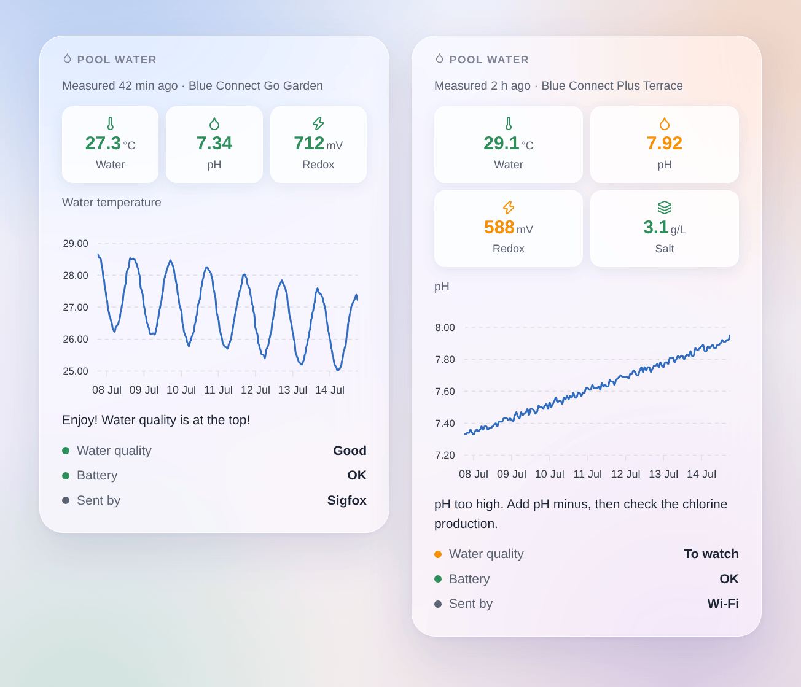

# Blue Riiot

## Overview

This integration brings the **Blue Connect** pool analysers of your Blue Riiot account into Gladys:

- a device per Blue Connect: water temperature, pH, redox (ORP), salinity on the models that measure it, the water quality against the ideal ranges of Blue Riiot, the advice of the app, and the battery;
- scene triggers (new measure, value out of its ideal range, value back in range, new advice, battery low, no measure for 48 hours) and two scene actions (read a Blue Connect; ask the Blue Extender for its newest measure);
- a "Pool water" dashboard widget.

Blue Riiot has no local API and no public one: the Blue Connect sends its measures to the Blue Riiot cloud, and the integration reads them through the **cloud interface of the Blue Connect app**, with the e-mail and password of your account (cloud transport). That interface is not documented by Blue Riiot and may change without notice. Your password only goes to the Blue Riiot login, at `api.riiotlabs.com`.

## Requirements

- Gladys Assistant 5.3.0 or later.
- A Blue Connect (Go, Plus, Gold…) already working in the Blue Connect app.
- The e-mail and password of that account, the ones you type in the app.

## Configuration

1. Integrations → Blue Riiot → Configuration.
2. Enter the e-mail and password, then save.

| Field                  | Description                                                                                      |
| ---------------------- | ------------------------------------------------------------------------------------------------ |
| E-mail                 | The e-mail of the Blue Connect account.                                                          |
| Password               | Stored as a secret, never shown again and never logged; only sent to the Blue Riiot login.       |
| Reading interval (min) | 10 to 120 minutes, 30 by default. A Blue Connect measures every 20 minutes to a few hours.       |
| Language of the texts  | Feature names, advice of the app and scene summaries. Automatic: the language of your dashboard. |

**Test the account** logs in and tells how many pools and Blue Connect devices the account has.

If Blue Riiot refuses the e-mail or the password, the readings **pause** so that the account is not locked by repeated tries. Correct the password and save (or click **Test the account**): they start again.

## Usage

### Devices

Devices → Blue Riiot → **Discover**, then add your Blue Connect ("Blue Connect Go Garden", after the model and the name of the pool in the app). Its values appear at once.

| Feature           | Gladys type                                                                  |
| ----------------- | ---------------------------------------------------------------------------- |
| Water temperature | Temperature sensor, °C                                                       |
| pH                | pH sensor                                                                    |
| Redox (ORP)       | ORP sensor, mV                                                               |
| Salinity          | Level sensor, ppm (3.2 g/L = 3200 ppm), only on the models that measure salt |
| Water quality     | Text: Good, To watch or Out of range: the worst of pH, redox and salinity    |
| Blue Riiot advice | Text: the advice of the Blue Connect app                                     |
| Battery low       | Battery low                                                                  |

The ideal ranges are the ones Blue Riiot sends with each measure (for instance pH 7.2 to 7.6). The test strips entered in the app are not device values: the scene action gives them as they are. Nothing can be controlled from Gladys.

### Scenes

Triggers:

- **Blue Riiot: new measure**: each new measure, with its values and the water quality as variables.
- **Blue Riiot: value out of range**: a measure (temperature, pH, redox, salinity) leaves its ideal range, or goes from "out of range" to "far out of it" (critical). Filter on the measure and the level.
- **Blue Riiot: value back in range**: a measure comes back into its ideal range.
- **Blue Riiot: new advice**: the app gives another advice; its code, title and message as variables.
- **Blue Riiot: battery low**: the battery of the Blue Connect turns low.
- **Blue Riiot: measures stopped**: no measure for 48 hours (battery, Sigfox coverage, Blue Extender). Fired once.

Actions:

- **Blue Riiot: read a Blue Connect**: temperature, pH, redox, salinity, conductivity, the last test strip (free chlorine, alkalinity), water quality, battery, advice and a ready-made sentence.
- **Blue Riiot: fetch from the Extender**: asks the cloud to take over the newest measure the Blue Extender keeps, like the Wi-Fi refresh of the app. It does not start a measure; the values arrive with the next reading. At most once every 10 minutes per Blue Connect.

Examples:

- When the pH goes out of range → send a message with `{{triggerEvent.data.summary}}`.
- When the redox is critical → switch the salt chlorinator plug on for two hours.
- Every evening at 8 pm → read the Blue Connect, then send its summary.

### Widget

Dashboard → Edit → add **Pool water**. Choose the Blue Connect, the chart (temperature, pH, redox, salinity or none) and its period. The tiles are green, orange or red after the ideal ranges of Blue Riiot. The chart shows the history Gladys keeps: it appears once the device is added.

## Troubleshooting

- **"Blue Riiot refused the e-mail or password"**: check them in the Blue Connect app, correct them and save. The readings are paused until then.
- **No device in Discover**: no Blue Connect is paired with a pool of the account, or the cloud has not been read yet: use "Test the account".
- **"No measure yet"**: the Blue Connect has not sent a measure to the cloud yet.
- **Values late or missing**: a Blue Connect Go without a Blue Extender only sends its measures when a phone with the app is nearby. With an Extender, the scene action "fetch from the Extender" brings its newest measure.
- **"Blue Riiot sent an unexpected answer"**: the interface of the app may have changed; open an issue.
- **"The Blue Riiot cloud does not answer" or "Blue Riiot limits the requests"**: the integration tries again at the next reading.
- **Logs**: add the environment variable `DEBUG=gladys-integration-sdk`, then open an issue on [GitHub](https://github.com/William-De71/gladys-blue-riiot/issues) with the Gladys and integration versions and the logs (the password never appears in them).
