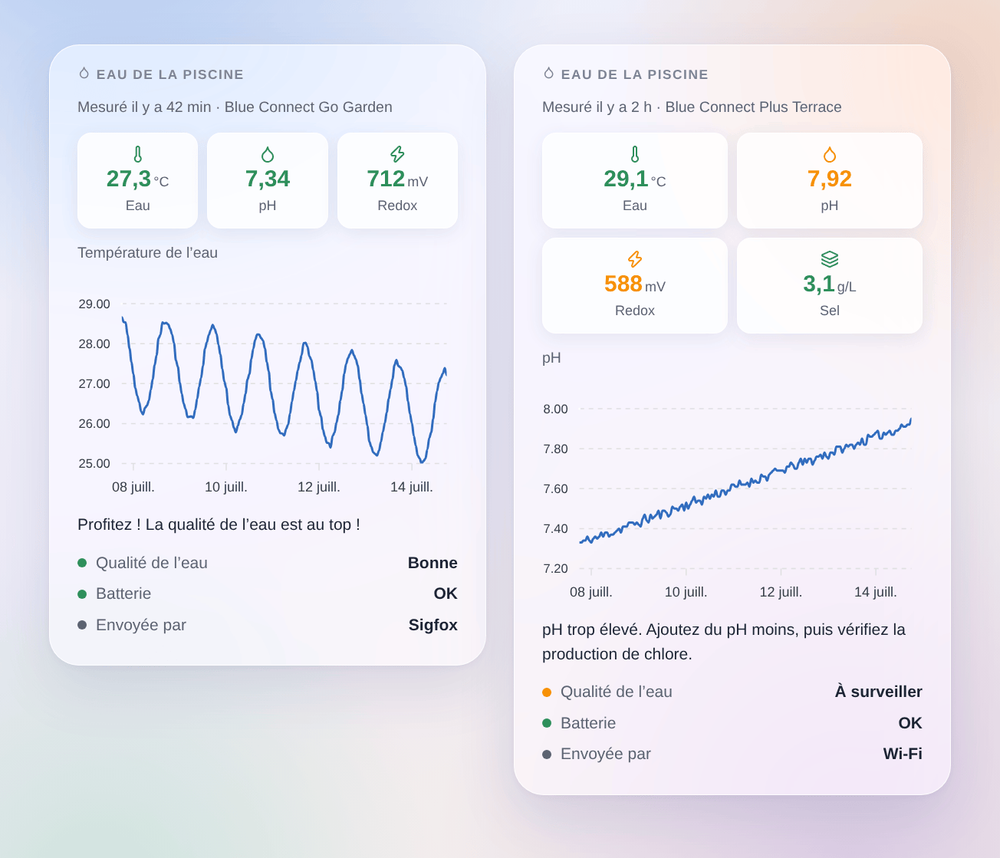

# Blue Riiot

## Présentation

Cette intégration amène dans Gladys les analyseurs de piscine **Blue Connect** de votre compte Blue Riiot :

- un appareil par Blue Connect : température de l’eau, pH, redox (ORP), salinité sur les modèles qui la mesurent, qualité de l’eau selon les plages idéales de Blue Riiot, conseil de l’application et batterie ;
- des déclencheurs de scène (nouvelle mesure, valeur hors de sa plage idéale, valeur revenue dans la plage, nouveau conseil, batterie faible, aucune mesure depuis 48 heures) et deux actions de scène (lire un Blue Connect ; demander au Blue Extender sa dernière mesure) ;
- un widget de tableau de bord « Eau de la piscine ».

Blue Riiot n’a ni API locale ni API publique : le Blue Connect envoie ses mesures au cloud Blue Riiot, et l’intégration les lit par l’**interface cloud de l’application Blue Connect**, avec l’e-mail et le mot de passe de votre compte (transport cloud). Cette interface n’est pas documentée par Blue Riiot et peut changer sans prévenir. Votre mot de passe ne part que vers la connexion Blue Riiot, sur `api.riiotlabs.com`.

## Prérequis

- Gladys Assistant 5.3.0 ou plus récent.
- Un Blue Connect (Go, Plus, Gold…) qui fonctionne déjà dans l’application Blue Connect.
- L’e-mail et le mot de passe de ce compte, ceux que vous tapez dans l’application.

## Configuration

1. Intégrations → Blue Riiot → Configuration.
2. Saisissez l’e-mail et le mot de passe, puis enregistrez.

| Champ                       | Description                                                                                                                  |
| --------------------------- | ---------------------------------------------------------------------------------------------------------------------------- |
| E-mail                      | L’e-mail du compte Blue Connect.                                                                                             |
| Mot de passe                | Enregistré comme secret, jamais réaffiché ni écrit dans les logs ; envoyé seulement à la connexion Blue Riiot.               |
| Intervalle de lecture (min) | De 10 à 120 minutes, 30 par défaut. Un Blue Connect mesure toutes les 20 minutes à quelques heures.                          |
| Langue des textes           | Noms des fonctionnalités, conseils de l’application et résumés des scènes. Automatique : la langue de votre tableau de bord. |

**Tester le compte** se connecte et indique combien de piscines et d’appareils Blue Connect compte le compte.

Si Blue Riiot refuse l’e-mail ou le mot de passe, les lectures se mettent **en pause** pour que des essais répétés ne bloquent pas le compte. Corrigez le mot de passe et enregistrez (ou cliquez sur **Tester le compte**) : elles reprennent.

## Utilisation

### Appareils

Appareils → Blue Riiot → **Découvrir**, puis ajoutez votre Blue Connect (« Blue Connect Go Jardin », d’après le modèle et le nom de la piscine dans l’application). Ses valeurs apparaissent aussitôt.

| Fonctionnalité       | Type Gladys                                                                                |
| -------------------- | ------------------------------------------------------------------------------------------ |
| Température de l’eau | Capteur de température, °C                                                                 |
| pH                   | Capteur de pH                                                                              |
| Redox (ORP)          | Capteur ORP, mV                                                                            |
| Salinité             | Capteur de niveau, ppm (3,2 g/L = 3200 ppm), seulement sur les modèles qui mesurent le sel |
| Qualité de l’eau     | Texte : Bonne, À surveiller ou Hors plage : la pire du pH, du redox et de la salinité      |
| Conseil Blue Riiot   | Texte : le conseil de l’application Blue Connect                                           |
| Batterie faible      | Batterie faible                                                                            |

Les plages idéales sont celles que Blue Riiot envoie avec chaque mesure (par exemple pH de 7,2 à 7,6). Les bandelettes de test saisies dans l’application ne sont pas des valeurs de l’appareil : l’action de scène les donne telles quelles. Rien ne se pilote depuis Gladys.

### Scènes

Déclencheurs :

- **Blue Riiot : nouvelle mesure** : chaque nouvelle mesure, avec ses valeurs et la qualité de l’eau en variables.
- **Blue Riiot : valeur hors plage** : une mesure (température, pH, redox, salinité) sort de sa plage idéale, ou passe de « hors plage » à « très en dehors » (critique). Filtrez sur la mesure et le niveau.
- **Blue Riiot : valeur revenue dans la plage** : une mesure revient dans sa plage idéale.
- **Blue Riiot : nouveau conseil** : l’application donne un autre conseil ; son code, son titre et son message en variables.
- **Blue Riiot : batterie faible** : la batterie du Blue Connect devient faible.
- **Blue Riiot : mesures arrêtées** : aucune mesure depuis 48 heures (batterie, couverture Sigfox, Blue Extender). Déclenché une fois.

Actions :

- **Blue Riiot : lire un Blue Connect** : température, pH, redox, salinité, conductivité, la dernière bandelette (chlore libre, alcalinité), qualité de l’eau, batterie, conseil et une phrase toute prête.
- **Blue Riiot : relever l’Extender** : demande au cloud de récupérer la dernière mesure que garde le Blue Extender, comme l’actualisation Wi-Fi de l’application. Cela ne lance pas de mesure ; les valeurs arrivent avec la lecture suivante. Au plus une fois toutes les 10 minutes par Blue Connect.

Exemples :

- Quand le pH sort de sa plage → envoyer un message avec `{{triggerEvent.data.summary}}`.
- Quand le redox est critique → allumer la prise de l’électrolyseur au sel pendant deux heures.
- Chaque soir à 20 h → lire le Blue Connect, puis envoyer son résumé.

### Widget

Tableau de bord → Modifier → ajoutez **Eau de la piscine**. Choisissez le Blue Connect, le graphique (température, pH, redox, salinité ou aucun) et sa période. Les tuiles sont vertes, orange ou rouges selon les plages idéales de Blue Riiot. Le graphique affiche l’historique que garde Gladys : il apparaît dès que l’appareil est ajouté.

## Dépannage

- **« Blue Riiot a refusé l’e-mail ou le mot de passe »** : vérifiez-les dans l’application Blue Connect, corrigez-les et enregistrez. Les lectures restent en pause jusque-là.
- **Aucun appareil dans Découvrir** : aucun Blue Connect n’est associé à une piscine du compte, ou le cloud n’a pas encore été lu : utilisez « Tester le compte ».
- **« Pas encore de mesure »** : le Blue Connect n’a pas encore envoyé de mesure au cloud.
- **Valeurs en retard ou absentes** : un Blue Connect Go sans Blue Extender n’envoie ses mesures que lorsqu’un téléphone avec l’application est à proximité. Avec un Extender, l’action de scène « relever l’Extender » fait remonter sa dernière mesure.
- **« Blue Riiot a envoyé une réponse inattendue »** : l’interface de l’application a peut-être changé ; ouvrez une issue.
- **« Le cloud Blue Riiot ne répond pas » ou « Blue Riiot limite les requêtes »** : l’intégration réessaie à la lecture suivante.
- **Logs** : ajoutez la variable d’environnement `DEBUG=gladys-integration-sdk`, puis ouvrez une issue sur [GitHub](https://github.com/William-De71/gladys-blue-riiot/issues) avec les versions de Gladys et de l’intégration et les logs (le mot de passe n’y apparaît jamais).
